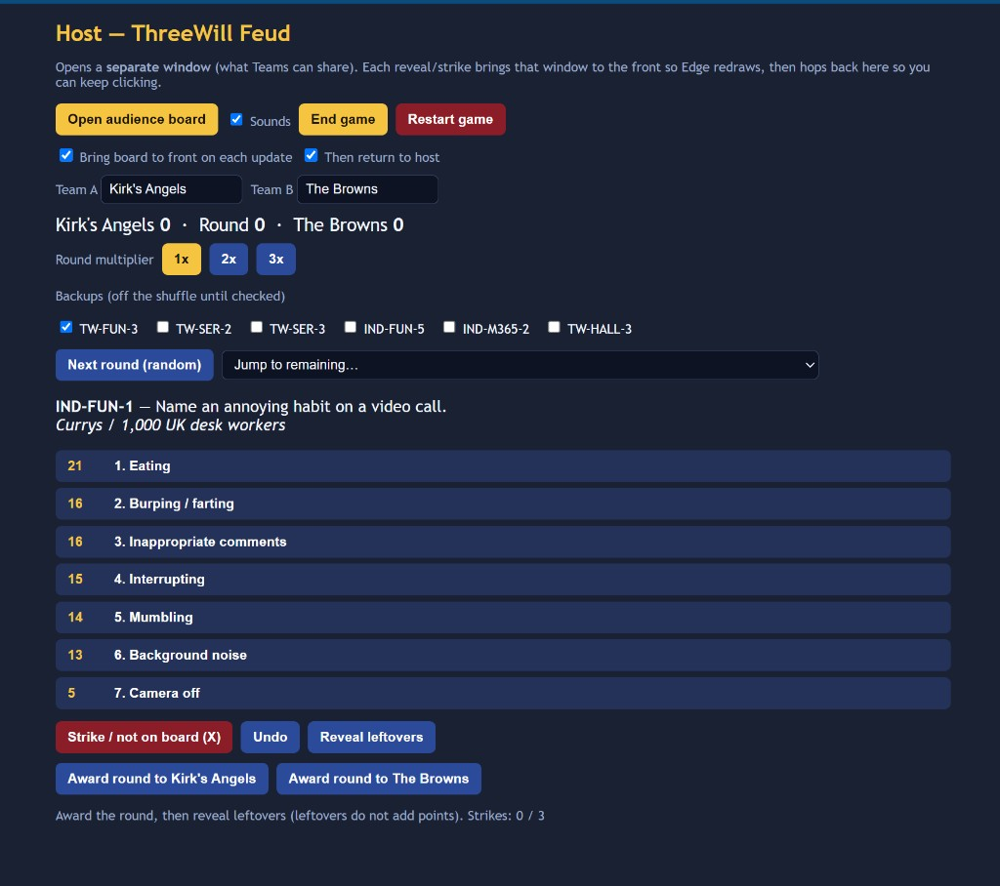
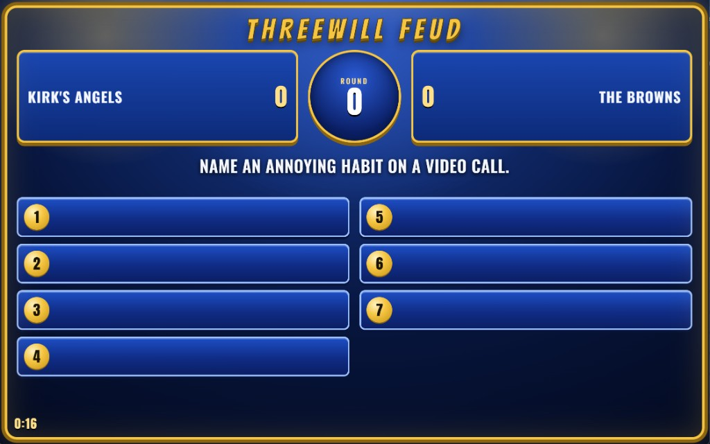

# Feud

A local **host + audience** board for a Family Feud–style show. You drive the game from a private host page; the room sees a separate window you share in Teams (or a projector). Surveys load from a **JSON pack** on disk — any set of questions, not just the sample.

**Not** official Family Feud. No licensed logos or rips; ding/X are synthesized CC0-style stand-ins.





## What it does

Two windows stay in sync (BroadcastChannel + `localStorage`). The host reveals answers, calls strikes, awards the round, and optionally ends the show or runs lightning. The audience sees numbered slots, family scores, the round pie, a running clock, and overlays (X, steal, winner).

**A round (main game)**

1. **Start / random board** (or jump to a remaining id). Backups stay off the shuffle until you check them in.
2. **Show question** so the audience sees the prompt (slots still hidden). The clock starts on the first show of the night.
3. **Showdown** — one person from each family buzzes (buzzers are physical; the app does not detect them). Wrong answers: **Showdown X** — the audience gets an X overlay, but it does **not** count toward three strikes. You can showdown-X back and forth without Undo.
4. Highest face-off answer (or host judgment) plays. Reveal matching answers from the host list (ding). Misses after a family is playing: **Family play X (n of 3)** — `n` is the strike count *if you click*. At 3, steal is open: the other family gets one remaining answer. If they miss, award the family that was playing.
5. **Award round** to A or B. Leftover reveals after award do not add points. **1x / 2x / 3x** multiplies the running round total (tile points stay at survey pie). Multiplier resets on the next board.
6. Repeat until someone hits the win score, you click **End game**, or you run out of boards.

**How a show ends**

- Pack (and host **Win at**) set an auto-win score, or leave it blank for no auto-win.
- **End game** freezes a winner overlay from the current scores, including a tie.
- **Lightning round** (optional): if the pack has lightning questions and the host checkbox is on, End game / hitting the target names the leading family, then Fast Money — two players, host-timed, steal if they miss the lightning target. Host can turn lightning on or off for this show; it sticks through Restart.

**Audience hop** — each host update can bring the board window forward so Edge paints under Teams window-share, then return to the host (~0.4s). Uncheck those options if you do not want the hop.

## Run

```bash
npx serve .
```

Open the URL (usually http://localhost:3000) for the **host**. Allow pop-ups, then **Open audience board** — share *that* window. Do not double-click the HTML (`file://` cannot fetch packs).

Sounds play on the **host** PC (so the room hears them on your mic). Mute on the host page if hardware buzzers are enough.

## Packs

A pack is one JSON file: title, default family names, boards (`live` / `backup`), win rules, and optional lightning questions. Point `config.json` at it, or open `?pack=packs/yours.json`. Storage is namespaced per pack id so two shows do not collide.

| Host control | Pack default |
|---|---|
| Team names | `families.a` / `families.b` |
| **Win at** (blank = no auto-win) | `win.targetPoints` |
| **Lightning round** checkbox | `lightning.enabled` (needs `lightning.questions`) |
| **End game** button | `win.hostCanEnd` |

- Sample: [`packs/october-qad.json`](packs/october-qad.json) (ThreeWill QAD 2026; 500, End game on, lightning off)
- Schema and field list: [`packs/schema.json`](packs/schema.json), [`docs/pack-spec.md`](docs/pack-spec.md)

Points on each board are a **pie** (typically 100): clustered survey share, unique-person collapse if both of someone’s answers land in the same cluster, Hamilton remainder so the board sums to 100.

## Import a Microsoft Forms survey

```bash
pip install -r requirements.txt
python -m feudpack import "Survey.xlsx" -o packs/myshow.json --id myshow --title "Our Feud"
```

Expected columns: `{question} — first answer` and optional `{question} — second answer (optional)`. The CLI clusters similar answers, writes the pack, and a sibling `.review.md` of raw strings — tidy labels in the JSON before air. Details and flags: [`docs/pack-spec.md`](docs/pack-spec.md).

```bash
python -m pytest -q
```

## Sounds

Synthesized CC0-style ding/buzzer in `sounds/` (not Family Feud rips). See [`sounds/README.md`](sounds/README.md).

## License

[MIT](LICENSE). Not affiliated with Family Feud.
