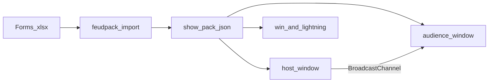

# Productize ThreeWill Feud

## Today (what does not work yet)

The engine lives only under [docs/qad/feud](docs/qad/feud): static `index.html` / `board.html` + [app.js](docs/qad/feud/app.js) + hardcoded [boards.js](docs/qad/feud/boards.js). There is no pack loader. Win-at-**500** is baked into `award()`, and Fast Money / lightning does not exist (QAD rules said none). Branding, `localStorage` key `tw-feud-state-v1`, and BroadcastChannel `tw-feud` are ThreeWill-specific.

## New repo and workspace

- Create sibling folder `C:\Users\MikeHomol\Development\Internal\feud` (or `threewill-feud` if the name is taken) with `git init` via Cursor `create_repo` (sandbox blocks shell `git init`).
- Copy the working static app (HTML/CSS/JS, synthesized CC0 `sounds/`). Do **not** copy ThreeWilly canvas/AGENTS/threeforce files.
- **Yes — move this agent to that folder as the workspace root** (`move_agent_to_root`) as soon as the directory exists, so pack loader / lightning / importer work happens in Feud, not mixed into ThreeWilly. ThreeWilly stays its own project; this chat just changes which folder is open.
- `gh repo create threewill/feud` (confirm public vs private at create time) and push `main`.
- Write the ThreeWilly README pointer **before** the workspace switch (or reopen ThreeWilly afterward). Leave [docs/qad/feud](docs/qad/feud) in place; no drive-by rewrite of the October QAD runbook.

## Show pack spec (runtime source of truth)

One JSON file per event, e.g. `packs/october-qad.json`, validated by `packs/schema.json`. App loads it with `fetch` (still `npx serve` — no `file://`). Query `?pack=packs/october-qad.json` or a tiny `config.json` default.

Pack shape (conceptual):

- `id`, `title`, `families` default names
- `win`: `targetPoints` (number or `null` = no auto-win), `hostCanEnd` (End game button), `onTarget` (`banner` | `endAndMaybeLightning`)
- `lightning`: `enabled`, `target` (classic 200), `player1Seconds` (15), `player2Seconds` (20), `steal` (other family one guess), `questions[]` (5 boards: question + answers + pts)
- `boards[]`: `id`, `pool` (`live` | `backup`), `source`, `question`, `answers[{text, pts}]`

App changes in `app.js`:

- Stop reading `window.TW_FEUD_BOARDS`; load pack, namespace storage/channel as `feud-{pack.id}` so two shows do not collide.
- Substitute `pack.title` on host/audience (drop hardcoded “ThreeWill Feud” except as the October sample title).
- Auto-win uses `pack.win.targetPoints` instead of `500`; hide End game when `hostCanEnd` is false.
- If lightning is disabled, End game / hitting target behaves as today (sticky winner overlay).
- If lightning is enabled, End game or hitting target **does not finish the show**: it names the leading family, then host starts lightning for that family.

## Lightning round (optional, pack-driven)

Host-operated Fast Money, not buzz-in:

1. Winning family (or leader at End game). Tie at End game with lightning on: host picks family A or B.
2. Five questions from `pack.lightning.questions`. Player 1 timer, then player 2 on the same five (duplicates blocked). Host clicks the matching answer or “not on board.”
3. If combined pts ≥ `lightning.target`, they win the lightning pot overlay. If not and `steal` is true, other family gets one steal guess on a missed answer.
4. Audience: stacked 5-row board + countdown (reuse existing overlay/clock styling).

If `lightning.enabled` is false, none of this UI is shown.

## Importer (full cluster pipeline)

Python CLI in the new repo, e.g. `python -m feudpack import path/to/Forms.xlsx -o packs/myshow.json`.

**Input spec** (document in README): Microsoft Forms export, header row, identity columns (`ID`, times, `Email`, `Name`), then one or two columns per prompt named `{question} — first answer` and optional `{question} — second answer (optional)`. Other column naming can be documented as an escape hatch (CSV of `question,answer,respondent`).

**Cluster rules** (same as the QAD pie):

- Per question: collect answers per respondent; **unique-person collapse** if both of their answers land in the same cluster.
- Normalize (case, punctuation, whitespace) then **fuzzy-merge** (RapidFuzz token set / ratio with a conservative threshold, overridable).
- Points = cluster’s share of the pie; **Hamilton largest-remainder** so each live board sums to 100 (document when a board stays off-100 if the host opts out).
- Emit `live` vs `backup` using simple heuristics or flags (`--live-ids`, `--max-live`).
- Write a **review report** (`packs/myshow.review.md`) listing raw strings in each cluster so the host can edit the JSON before air.

This will not match hand-clustered QAD labels 1:1 (e.g. Tim’s “Grant and his casual approach”); the JSON remains the place to rename clusters. Ship `packs/october-qad.json` transcribed from current `boards.js` as the golden sample (importer is for the *next* show).

Lightning questions: `--lightning-count 5` pulls unused / extra prompts into `lightning.questions`, or the host copies boards into that section by hand. Default sample pack: `lightning.enabled: false` to match how October actually ran.

## Docs in the new repo

- README: `npx serve`, open host, Open audience board, hop/focus notes, pack query string.
- `docs/pack-spec.md`: schema fields, win/lightning, Forms column contract, pie/cluster rules.
- Sample pack + `config.json` pointing at it.

## Out of scope

- Official Family Feud assets/sounds (keep CC0 stand-ins).
- Server, accounts, or cloud survey hosting.
- Changing Cursor Origin remotes; this is GitHub `threewill/feud` only.

