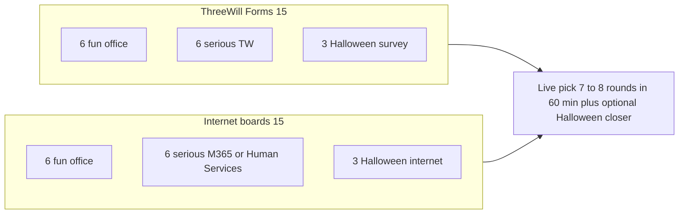

# QAD Corporate Feud starter runbook

## What Kirk already locked in

From Kirk’s 9/21 chat (and your “I’m up for it”):

- You own the **October QAD team builder**.
- Format: **Corporate Feud** (Family Feud rules: survey-ranked answers, strikes, steal).
- Tone: funny, personalized, everyone plays, easy to run.
- His seed topics: projects going off track, common client request, best core value, favorite EOS tool. **Do not use closed lists as boards** (five core values, a handful of EOS tools). Recast those as open-ended “name a…” questions so 3-strike play still works.
- He prefers **real answer counts** (survey) over Copilot inventing the board.
- **Goofy prizes**; Linda can buy them.

Calendar: **ThreeWill Quarterly All Day**, Thursday **2026-10-15**, 7:30 AM–5:00 PM, **148 Iron Mountain Rd, Canton, GA**. **Target slot: ~60 minutes.** Runbook also includes a **~45-minute cut** (drop 2 rounds, skip Fast Money). Confirm the actual agenda slot with Kirk after the runbook exists.

## Question mix (locked)

Keep Kirk’s game. **50/50 fun vs serious** on both ThreeWill and industry. Halloween is a small extra pool, not a third equal track.

### Board-size rule (non-negotiable)

Classic 3-strike Feud needs a **wide answer field**. A question whose true answer set is 5 core values (or ~6 EOS tools) dies after two misses.

For **every** prompt in the runbook:

- Phrase as **“Name a …” / “Top reason …” / “Something a client …”** — free text, not a pick-list.
- **Playable only if** clustering (or the cited internet table) yields **at least 7 distinct answers**. Target **7–8 on the board** (top answers shown; leftovers grouped into “other” off-board).
- **Do not use** Kirk’s “best ThreeWill core value” as written. Recast values as behaviors, e.g. “Name something a ThreeWiller does that shows we live our values.” Same for EOS: not “favorite EOS tool,” but “Name a way EOS/L10 actually helps (or gets in the way) on a ThreeWill engagement.”
- Keep “projects off track” and “most common client request” — those naturally branch.
- After survey close: if a TW question clusters to **fewer than 6** answers, **bench it**. Do not silently drop to 2 strikes except as a last-resort backup labeled in the host sheet.
- Industry sources: pick surveys that already publish **7+ ranked responses**, not 4-bar charts.

### ThreeWill Forms (15 questions, send to the company)

All free-text, one answer, anonymous. Cluster into **Top 7–8** after close (not 5).

- **6 fun office** — humorous workplace (snacks, meeting habits, remote-life, QAD lore). Not client-sensitive. Must still have a wide answer space (favorite candy-style, not “Teams or Zoom”).
- **6 serious** — **only** ThreeWill business: recent clients, **values as lived behaviors**, core process (how we deliver, L10/IDS in practice). Open-ended only. Fill from Kirk’s usable seeds plus extras (what clients thank us for, why a project slips, what “good” looks like on an MS engagement).
- **3 Halloween** — light survey items (example: favorite candy). These are the only Halloween questions Threewillers answer.

### Industry internet bank (12 questions, none on the Forms)

**Every industry board is sourced from a published survey** (title, org, year, URL in the runbook). Do not invent ThreeWill-looking percentages for these.

- **6 fun office** — humorous office questions that already exist on the internet (office pet peeves, meeting sins, snack polls, remote-work quirks) with real ranked answers.
- **6 serious** — **Microsoft 365 solutions** and/or **Human Services** industries only (adoption, Copilot/M365 usage, case management, workforce, outcomes). Cite the study. Split the six across those two realms if sources allow (target ~3 M365 / ~3 Human Services).

### Halloween pool (6 total, limited)

- **3 from the internet** — published Halloween/candy/costume rankings (e.g. NCA candy sales, YouGov costume polls). Ready-made boards; not on the Forms.
- **3 on the ThreeWill survey** — as above (favorite candy and two similar).

Live show: at most **one Halloween closer** unless time is fat.

### Live selection vs banks

You will have **27 non-overlapping prompts** in the runbook (15 TW + 12 industry) plus **3 extra internet Halloween**. On QAD for **~60 minutes**, pick **7–8 playable rounds** (about half fun / half serious, mix TW + industry) and **at most one Halloween closer**. Budget roughly:

- 5 min: teams, rules, buzzers
- 7–8 rounds × ~6–7 min (face-off + play + steal)
- 5 min: prizes / wrap
- Fast Money only if you are ahead of pace

**~45-minute cut:** 5 rounds, no Halloween, no Fast Money. The rest of the bank is backup if a board is too thin after clustering.

No live app, canvas, or Forms creation in this pass unless you ask later. Artifact is a **runbook you can edit**.

## Deliverable

Add a single markdown runbook:

[`docs/qad/2026-10-corporate-feud.md`](docs/qad/2026-10-corporate-feud.md)

Sections:

- **One-pager** — purpose, duration, roles (you host; optional scorekeeper; Kirk as “survey says” if he wants).
- **Pre-QAD timeline** (working backward from 10/15):
  - This week: lock the **15 Forms questions**; you send Forms (or Kirk/Linda) with a ~5–7 minute ask.
  - Close survey ~**10/10**.
  - Cluster ThreeWill answers; **bench any board with fewer than 6 clustered answers**.
  - Confirm industry/Halloween internet boards have **7+ published ranks**.
  - Pick 7–8 play rounds + backups.
  - Prize **and buzzer** list to Linda by **10/8**.
- **ThreeWill survey bank** — all 15 prompts written out, tagged `TW-fun` / `TW-serious` / `TW-halloween`, copy-paste into Forms.
- **Industry internet bank** — all 12 prompts written out, tagged `IND-fun` / `IND-serious-M365` / `IND-serious-HS`, each with **source + year + URL**. Ranked answers filled from the citation (or marked “fill from source table” if we must verify a number at write time—never unlabeled invented stats).
- **Halloween internet 3** — same citation treatment as industry.
- **Live rules (classic Feud)** —
  - Split the room into **2 families**.
  - Each round: **one representative** per team at the podiums.
  - You read the survey question. First to **buzz** (or blurt, if no buzzers) and give an answer **on the board** wins the face-off **unless** it is not the #1 answer — then the other rep may try for a **higher-ranked** answer. Highest correct answer on the face-off **plays**.
  - Winning family works the rest of the board. **3 strikes**. After 3 misses, the other family gets **one confer-and-steal** (one answer; if it is on the remaining board they take the points).
  - Points = clustered survey counts (or published percents on industry boards), scaled so a clean board is ~100.
- **Host cheat sheet** — 60-min round order (mix TW + industry, keep fun/serious balanced, optional Halloween closer); 45-min cut; what to skip.
- **Buzzers** — short buy list of **cheap/fun** 2-player buzzers (Amazon-style game-show buttons, wireless doorbells, horns) for Linda; **fallback: blurt + host judgment**. Do not order anything in this pass.
- **Prize ideas** — goofy, cheap, in-character. Combined Linda checklist with buzzers.
- **Draft ping to Kirk** — 5-line “here’s the plan / please put 5 min on the company chat for the survey” you can send after you remix.
- **Open remix list** at the bottom (team names, Fast Money, whether remote folks play, etc.) so later changes stay local to that file.

## Explicitly out of scope until you say so

- Sending the survey, Teams messages, or email to Kirk/Linda.
- Building a PowerPoint/clicker board or canvas.
- Committing the file (write locally; commit only if you ask).

## After you approve this plan

Write the runbook with **all 30 unique questions listed** as open-ended wide boards (not TODOs, not 5-value pick-lists). Include a **60-minute rundown** and face-off/buzz/#1-challenge/3-strike steal script. ThreeWill answer keys stay **illustrative until the survey closes**. Industry and internet Halloween boards must carry a real citation and **7+ published ranks**; if not, leave answer rows blank with the source link. Timeline dated against **2026-10-15**. Cheap buzzer options listed, not purchased.

