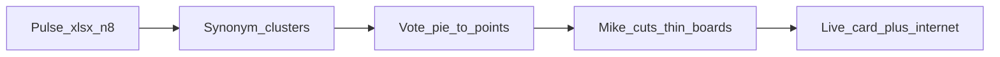

# Cluster Pulse answers and lock the live Feud set

Work only in [`docs/qad/2026-10-corporate-feud.md`](docs/qad/2026-10-corporate-feud.md). Do **not** edit `.cursor/plans/qad_corporate_feud_5513b6fa.plan.md`. No Forms resend, prizes, or git commit.

Source: `C:\Users\MikeHomol\Downloads\ThreeWill Pulse for October 2026(1-8).xlsx` — 8 people (Kirk, Tommy, Caroline, Tim, Will, Linda, Kristi, Mike), 13 topics (not the old 14). **TW-FUN-2** (workday snack) was never on this form. **TW-SER-4** went out as a **gross-margin guess**, not EOS/L10.

## Scoring rule (all TW boards)

- Each non-empty answer is one vote. If both of one person’s answers land in the **same** cluster, count **once**.
- **Points = round(cluster votes / that question’s vote pie × 100)**. Off-board leftovers still occupy pie, so on-board rows will not always sum to 100 (same as Feud’s hidden singles).
- Host accepts close wording; clusters below are the reveal labels. After you cut, we can tighten labels.

## Proposed TW boards (cut candidates marked)

Percents use the pie rule above (rounded). **Bench / cut** = too many 1-vote rows, or not a “Name a…” board.

**Keep-first (playable even with small n)**

- **TW-FUN-1** Teams laugh/groan (pie 14): Tim’s jokes / potty-bathroom humor **36** · “There’s Mike” / walks in at the start **21** · Visual bits (Jim’s camel/shark, AI rock pics, funny outfit) **21** · Talking on mute **14** · Last-second extra question **7** (optional off-board)
- **TW-FUN-4** Favorite QAD memory (pie 12, Tommy skipped): Lawn games (Kubb / cornhole / putt-putt) **33** · Jenga **17** · Jackbox / Immersive Gamebox **17** · Grant-style casual games **8** · Breakout rooms **8** · Improv **8** · Group photo **8**
- **TW-FUN-5** Thrive snack (pie 12 after dropping “don’t have one” and collapsing Mike’s two sweets): Nuts / peanut snacks **33** · Bevi / soda / drink machine **25** · Chocolate / pastry **17** · Chips **8** · Fruit **8** · Granola bar **8**
- **TW-SER-1** Engagement off track (pie 10): Client unengaged / no-show / unresponsive **30** · Scope / “the client” changing **20** · Miscommunication **20** · Expectation / MS value-prop mismatch **20** · Too many clients at once **10**
- **TW-SER-5** Clients thank us for (pie 14): Care / listen / want them successful **29** · Responsiveness **21** · Quality / on time / good work **21** · Keep commitments **7** · Training **7** · Clear communication **7** · Expertise **7** · “Velvet hammer” **7**
- **TW-SER-6** What “good” looks like (pie 13): 2x value / hours saved **23** · Trust / happy / recurring client **15** · People actually use the work **15** · Full backlog / more requests than time / visible board **15** · Regular user contact / issues cleared fast **15** · Go-to M365 person **8** · High QIM / EOS scores **8**
- **TW-HALL-3** Halloween activity (pie 12): Pumpkin (carve / patch / roast seeds) **33** · Hand out candy / hang with neighbors **25** · Adult drinks / bonfire **17** · Buy/eat the candy ourselves **17** · Scary movie **8**

**Show you, likely cut**

- **TW-FUN-3** Phrase too often (pie ~11): Journey / partner-with-clients **27** · Cadence **18** · Dogfooding **18** · then four 9-point singles (hard stop, “oh Tim”, passion, “we lost XYZ client”). Thin #1, noisy rest.
- **TW-SER-2** Client request (pie 7; Tim+Linda skipped): M365 help (Teams / tasks / permissions) **43** · Organize/migrate content **14** · “Email that to me” **14** · More features **14** · Last-minute updates **14**. Only 5 rows.
- **TW-SER-3** Lived values (pie 10): Ownership / prepared / wear the customer hat **30** · Community volunteering **20** · then five 10-point singles (Better Together, responsive, protect backlog, humble confidence, learn/share tech).
- **TW-SER-4** MS gross-margin guess: first answers cluster as **~65% (38)**, then 64 / 62 / 70 / 60 / 35 as singles. Trivia, not Feud. Recommend **out of the live card**; keep the raw guesses in an appendix if you want to roast the room.
- **TW-HALL-1** Favorite candy (pie 14): Reese’s **21** · Butterfinger **14** · nine 7-point singles. Prefer **HALL-NET-1** as the candy round.
- **TW-HALL-2** Costume: Movie/TV character **~38** · Musician / parrothead / Willie **~25** · Classic cat/witch **~13** · sports jersey **~13**. **Omit Tim’s answer from any public board.** Weak vs HALL-NET-1 / TW-HALL-3.

## Internet set (keep only these; delete the rest from the live banks)

Leave citations in a short “benched sources” note so we do not lose URLs, but **remove from suggested live card**: IND-FUN-2/3/4/6, IND-M365-3, IND-HS-2/3, HALL-NET-2/3.

| ID | Status |
|---|---|
| **IND-FUN-1** | Keep as written (Currys percents). |
| **IND-FUN-5** | Keep Owl Labs hybrid-pain board. During edit, add 1–2 published rows if the U.S. 2024 report lists them so the board is 7+; otherwise play the six rows you already have and say so on the host sheet. |
| **IND-M365-1** | Keep ShareGate Copilot concerns. |
| **IND-M365-2** | Keep Copilot user-goal shares; play top 7–8 (tail is already tiny). |
| **IND-HS-1** | Keep CNP/PNP workforce challenges. |
| **HALL-NET-1** | Update to CandyStore **2026** national top 10 (M&M’s, Sour Patch Kids, Skittles, Reese’s, NERDS Gummy Clusters, Hot Tamales, Starburst, Candy Corn, Hershey’s Mini Bars, Butterfinger). Source still publishes **ranks / pounds, not shares**. Convert rank → pie with inverse-rank over the top 10: weight `(11 − rank) / 55`, so **18, 16, 15, 13, 11, 9, 7, 5, 4, 2**. Host line: “CandyStore ranks by Halloween pounds sold; they don’t publish percent share, so these points are that ranking turned into a 100-point pie.” Do **not** use state-win % — it fights the national order (e.g. Hot Tamales would outscore Skittles). |

## Live show changes

- **Delete Fast Money** from the one-pager, 60-min rundown, 45-min cut, host sheet, and remix list.
- **Win condition:** first family to **500**, or whoever is ahead when the hour is up (whichever comes first). Face-off boards are ~100 pie-points; with steals/strikes you need **~7–8 rounds** to hit 500 in ~60 minutes (classic 300 would end ~round 4).
- Replace the suggested live card with a **queued mix** you can still cut after reading the clustered tables, for example:
  1. TW-FUN-1
  2. IND-FUN-1
  3. TW-SER-1
  4. IND-M365-1
  5. TW-SER-5 or TW-SER-6
  6. IND-HS-1
  7. TW-FUN-4 or TW-FUN-5
  8. HALL-NET-1 (Halloween closer)
  Backups in the room: IND-FUN-5, IND-M365-2, TW-HALL-3.
- Sync the one-pager: survey is **closed**; scoring is **pie percent**; board-size rule relaxes for n=8 (play 5–7 clustered rows; do not force 7+ if it means inventing singles).
- Refresh host cheat sheet with the **actual clustered reveal lines** (hidden from the room).
- Fix stale copy (Forms 14 topics / EOS / FUN-2 / Fast Money / “illustrative until Oct 10”).
- Status line: starter pack → **post-survey board book**; still no prize order unless you ask.

## After you review

You pick which TW rows die. A follow-up pass (not this plan unless you include it now) can drop those boards from the live card only — raw clusters stay in an appendix so we do not lose the work.

