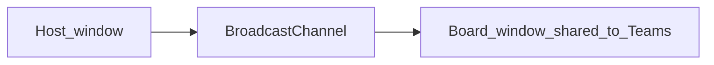

# Remote ThreeWill Feud board

PowerPoint will fight you (hidden answers, big X, round total, steal). A **tiny local site** (open two browser windows, share only the board window into Teams) matches the Family Feud TV layout and Kirk’s buzzers stay physical — the app does not detect buzzes.

QAD is tomorrow. Keep it static HTML/CSS/JS under [`docs/qad/feud/`](docs/qad/feud/) so you double-click and go. No npm, no Canvas (Canvas is a chat-side artifact, not a Teams share surface).

## How you run it on one monitor

1. Open `docs/qad/feud/index.html` twice (or `?view=host` and `?view=board`).
2. In Teams, **Share window** → the **board** window only. Camera stays on you.
3. Keep the host window on your machine (Alt-Tab, or a small strip Teams is not sharing). Clicks on the host list never appear on the shared board.

Sync both windows with `BroadcastChannel` (same origin / `file://` fallback: `localStorage` events). If `file://` is flaky, a one-line note: run `npx serve docs/qad/feud` — only if the file protocol fails in a 2-minute smoke test.

## Audience board (shared)

Classic look, **ThreeWill Feud** branding (no Family Feud logo):

- Question line
- Numbered slots (blank until revealed): label + points, Feud-style two-column grid
- **Round points** growing as answers flip
- **Two family scores** on screen at all times (editable names on the host side). Awarding a round adds that round total to the chosen family. A banner when either family crosses **500**.
- Full-screen **X / XX / XXX** overlay on a miss (auto-dismiss after ~1.5s, strikes stay marked)
- After 3 strikes, host can still steal; overlay says steal opportunity without leaking remaining answers
- End of round: optional “reveal leftover” (host button)

## Host window (private)

- **Shuffle / next round:** **Next round** (and the first board of the game) picks uniformly at random from boards **not yet played** in the enabled pool. Default pool = live-card boards (including HALL-NET-1 in the mix, not pinned as last). Backups (TW-FUN-3, TW-SER-2, TW-SER-3, IND-FUN-5, IND-M365-2, TW-HALL-3) are **off** the shuffle until the host checks them in. Dropped boards stay out.
- Manual override: a private dropdown still lists remaining boards if you need to skip a random pick.
- Show the host the chosen ID before it hits the audience board (one **Show question** click) so you can read it without leaking early.
- Full answer list with points; click = flip on the board and add to **round total**
- **Strike** (wrong / not on board)
- **Undo** last flip or last strike
- **Control / award:** Family A or B gets the round total (playing family or steal)
- **Next round** clears board + strikes, **keeps family scores**, then draws the next unused board
- Team name fields
- Face-off is host judgment: first on-board click does **not** auto-award; you award when the round is over (including steal miss → original family)
- **Restart game** (confirm first, so you cannot wipe the live show by accident): zeros both family scores, round points, strikes, and the played-board list so the shuffle starts over. Keeps team names, backup checkboxes, and sound toggle. Use this for test runs today and tonight.

## Data

One `boards.js` copied from the clustered tables in [`docs/qad/2026-10-corporate-feud.md`](docs/qad/2026-10-corporate-feud.md) (keep-first Pulse + six internet + backups). Integer points as already in the runbook; IND-M365-2 can round 27.5 → 28 for display.

## Sounds

Do **not** rip Family Feud / board-game audio (copyright). Use **similar gameshow** clips that are **CC0 / public domain**:

- Correct ding: [craigscottuk — Quiz Gameshow Correct Ding 01](https://freesound.org/people/craigscottuk/sounds/644945/) (CC0)
- Wrong X: [Breviceps — Buzzer sounds (Wrong answer / Error)](https://freesound.org/people/Breviceps/sounds/493163/) (CC0; take the shortest/sharpest take in the file) or, if that pack is too 8-bit, [Philip_Daniels — buzzer.wav](https://freesound.org/people/Philip_Daniels/sounds/259290/) (CC0, described as a game-show buzzer)

Save the two short files under `docs/qad/feud/sounds/` with a one-line `sounds/README.md` citing those URLs. Play ding on reveal, buzzer on Strike/X. **Sounds on by default**; host mute toggle if Kirk’s hardware already makes noise. Web Audio fallback tones only if the files fail to load.

## Runbook

Add a short **Remote host** section to the same markdown: two windows, share board only, buzzers stay physical, win at 500 still shown on the board (banner when a family crosses 500).

## Out of scope

- Cloud hosting, auth, clicker hardware integration
- Fast Money
- Pixel-perfect TV clone / official Family Feud sound rips or logos
- Building this as a Cursor Canvas

